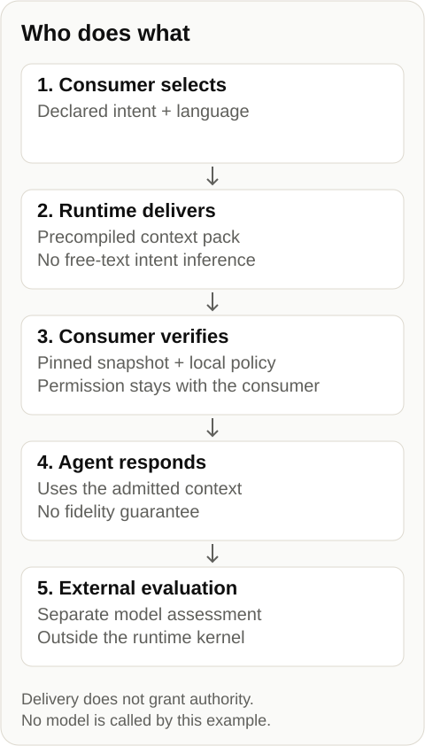

# Governed Context Runtime

**Give AI agents context they can verify.**

Governed Context Runtime delivers precompiled, versioned context packs with sources and explicit interpretation boundaries for a declared task. The consumer selects a canonical intent; the interface does not infer intent from free text, compose a pack at request time, generate an answer or judge a model.

[Open the hosted instance](https://context.gautierdorval.com/). The gautierdorval.com instance is accessible over HTTP and through a separate MCP adapter. This public repository provides proposed contracts, verifiers, integration guides and runnable offline examples for that instance, including its closed intent vocabulary and historical identifiers. The site remains the canonical source of its doctrine; this reference creates no new authority root.

## What you can use today

| Your goal | Available resource | Scope |
|---|---|---|
| Retrieve a declared context | [Hosted instance guide](instance.md) | The gautierdorval.com corpus; client compatibility is documented separately. |
| Inspect and verify context artifacts | [Verification guide](../verification.md) | Complete snapshot verification under a separately selected trust reference. |
| Learn the verification path offline | [Local demonstration](#try-it-locally) | Fictional data and test keys; no model invocation. |
| Inspect a complete pack | [Consumer kit](reproduction.md) | Admission, inspection and permission remain distinct. |
| Understand semantic boundaries | [Example and glossary](pack-semantics.md) | Fictional exercise, no observed model answer. |
| Examine local evidence | [Qualification](qualification.md) | Retained assets and local adapter, no current hosted diagnosis. |
| Prepare a comparison | [Four-condition pilot](model-comparison.md) | 560 planned responses per configuration, **NOT_RUN**. |

## When context loses meaning

Illustrative example: “Available in Quebec after technical assessment” becomes “Available across Canada.” The service is recognizable, but its geographic scope and a condition have changed. The project explores how to make supplied context and its boundaries identifiable and verifiable before evaluating what an agent preserves in its answer. This fictional example is not an observed model result or an available business pack.

Each pack is declared for one task, carries a reproducible version and makes its interpretation boundaries explicit. Consumers can inspect the context they receive before using it. The fidelity of an agent’s answer is evaluated separately.

## From selection to use



The consumer selects an intent and language. The runtime delivers the precompiled pack. Verification and permission remain local to the consumer. The agent produces its answer; any external assessment of that answer is a separate step.

## Instance scope

The gautierdorval.com instance is accessible over HTTP and through a separate MCP adapter. This public repository provides proposed contracts, verifiers, integration guides and runnable offline examples for that instance, including its closed intent vocabulary and historical identifiers. The site remains the canonical source of its doctrine; this reference creates no new authority root.

## Relationship with MCP and WebMCP

[MCP](https://modelcontextprotocol.io/specification/2026-07-28/server/tools) lets clients discover and invoke tools; resources can also carry context. The [instance guide](instance.md) describes the separate MCP adapter and its dated client checks. Transport success alone does not bind a returned pack to a verified snapshot.

[WebMCP](https://webmachinelearning.github.io/webmcp/) exposes tools from a page in a compatible browser. Such tools can search, read or return context as well as perform actions. The draft reviewed on 25 October 2026, dated 20 October 2026, uses `document.modelContext`; it is a Community Group draft, not a W3C standard or a Standards Track document. Tool descriptions, parameter schemas and annotations do not certify actual behaviour or answer fidelity. Input validation, business rules and authorization remain responsibilities of the relevant implementations.

The Runtime supplies precompiled context for a consumer-selected intent. This reference defines the artifact-verification path. The consumer still selects its trust reference, verifies the complete snapshot and decides admission and permitted use. Integrity does not establish truth or compliance with the pack’s interpretation boundaries. Publication and discovery do not establish use or measured benefit.

WebMCP could provide another interface to this path, but this reference contains no WebMCP bridge. This is an architectural possibility, with no implementation commitment: verifier success establishes neither WebMCP interoperability, compatibility with a particular agent client nor an effect on its answers. The existing four-condition pilot remains **NOT_RUN**.

## Reference version

Reference edition 0.2.1-proposed is a prerelease of proposed contracts. Cite v0.2.1-proposed and the exact executed commit; the GitHub release records its publication. The hosted service follows a separate publication lifecycle. This repository contains offline reference code and fictional examples, not the hosted service, its production corpus or a turnkey deployment for other domains.

## Choose context

Select representation-gap when an already identified model response appears to misrepresent the published entity or doctrine. Choose the language explicitly. Fetch the closed intent registry, select its exact pack identity, and bind the payload and detached manifest to a separately pinned corpus root before use.

## Try it locally

The existing demonstration concerns a fictional workshop and the distinction between an explanatory policy and permission to act.

Run npm run demo from the package root for the offline exercise. Its fictional fixture includes a signed receipt, test public-key policy, expected root, snapshot and every required archive. The fixed clock belongs to the exercise, not to current freshness. No installation, private account, download or model request is required. For the hosted instance, follow the integration guide and select an expected corpus root independently. The demo keys do not establish a production signing infrastructure.

```powershell
npm run demo
npm test
```

Node.js 24.17.0 or newer. Run from the repository root. Expected final demo status: `VERIFIED_FICTIONAL_CONTEXT`.

## Local permission

Verification establishes byte integrity under a declared format. The consumer then makes its own bounded permission decision. A valid JWS signature is not proof of truth, real-world identity, model fidelity, execution authority or later revocation status. DSSE and detached JWS are different formats.

## Unit integrity boundary

Verify the complete snapshot before using a unit. The historical v0 envelope covers its listed text and context fields, but not the selected source value, its type or the allowed and forbidden transformations. Their source and registry bytes are covered separately by the pinned snapshot. This establishes integrity, not agreement between a sentence and its source meaning. No semantic judge runs inside the runtime.

## Historical signatures

Historical signature inspection cannot authorize current use. The consumer path always rechecks the original receipt in current mode under its local policy. A timestamp signed by the same key is not an independent time witness. Retired keys cannot grant current permission; revoked keys are rejected even historically. Offline policy cannot establish later compromise.

## Applications to explore

| Application to explore | Context need | Still to evaluate |
|---|---|---|
| Business assistants and documentation | Supply an offer, definition or policy with conditions, exclusions and sources. | Adapted business corpus, integration cost and preservation of conditions in answers. |
| Multiagent systems | Identify the context version passed between steps and preserve its references. | Actual transmission of constraints, summaries and version handling by consumers. |
| AI response audits | Relate an experiment to the context supplied, then compare the answer with its conditions. | External captures, evaluation protocol and comparative results. |

These are applications to explore, not deployed integrations. The current service retains its declared intent catalogue; these examples introduce no new pack, native integration or commercial availability.

## When a page is enough

Use a static canonical page for a simple definition or an ordinary editorial citation. A pack is useful when the consumer needs the declared selection, dependencies and integrity scope together; it adds no authority merely by being a pack.

## Evidence

Keep dated producer observations of the hosted instance, local technical verification and external model experiments separate. A data archive, a public projection, this documentation and a site paragraph can describe the same archive; they are not four independent confirmations. Model-fidelity effects remain to be evaluated.

[Dated observations and evidence scope](../../evidence/README.md)

## Limits

The publication in evidence/publication.json is synthetic. Its digest supports integrity checks of that projection; it does not authenticate the source or measure the hosted service. Dated producer observations of the hosted instance are published separately. This projection establishes neither private source completeness, current deployment, spontaneous adoption nor causal effects on model answers.


In the fictional demonstration, a locally pinned root and test key policy precede receipt verification. The complete snapshot then binds archives, profiles, pack identities, unit references, source bytes and transformation registries. Both stages must succeed before local inspection. The bundled trust reference is educational, not a production signing service.

[Verification](../verification.md) · [Schemas](../schemas.md) · [Evidence](../../evidence/README.md) · [Security](../../SECURITY.md) · [Rights](../../NOTICE.md)

## Complete local pack inspection

[Reproduction kit](reproduction.md) · [Pack semantics](pack-semantics.md) · [Prepared model comparison](model-comparison.md).

[Offline qualification](qualification.md) · [Observation contracts](../observations.md) · [Hosted diagnostic dossier](../hosted-diagnostics.md) · [Reference prerelease](../release-0.2.1-proposed.md). The four-condition pilot is **NOT_RUN**.

## Local MCP Apps companion

[Choose and inspect a whole fictional pack](mcp-apps.md), then explicitly request its text-tool reading. The [T3 observation](../../records/mcp-apps-2026-10-26.md#selector-to-answer-qualification-t3-2026-10-27) completed the button-to-answer journey for one French pack in Claude Desktop 3.6556.2.0 after a prior cancellation; all 11 requested list entries matched. No real English trial or general fidelity claim. The native context-update channel remains experimental and unqualified. The comparative pilot remains **NOT_RUN**.
