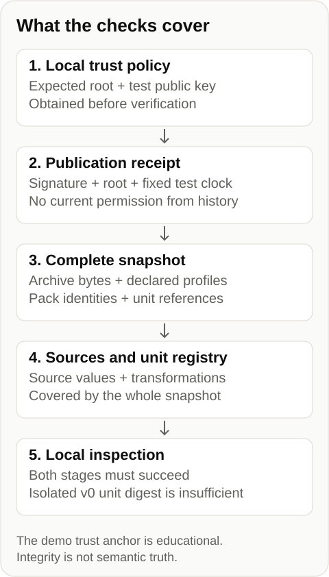

# Verification contract

This is an instance reference for proposed contracts, not a generic semantic validator. Select the declared intent and language outside the runtime. The complete offline path is `npm run demo`.



The consumer supplies a root and key policy before verification. The receipt must match that root. A separately verified signature is insufficient: verify the full finite snapshot, every addressed archive, declared algorithm/profile, pack identity and unit reference before using its contents. The example wrapper copies inputs before asynchronous checks and returns only after both stages succeed.

## Historical unit boundary

The v0 envelope hashes exactly `unitId`, `sourcePath`, `selector`, `claimClass`, `authorityScope`, `canonicalSource` and `canonicalText`. It does not hash the selected value, its type or transformation arrays. Source and complete registry bytes are instead bound by the whole snapshot. An isolated v0 digest must not be presented as a source-value or transformation attestation. Changed source bytes fail under the original root. A newly computed root still needs separate admission. Even an internally consistent admitted snapshot does not establish semantic truth.

## Byte profiles and addressing

[Attestation recipes](../spec/attestation-recipes.json) enumerate the profiles. The portable inventory profile accepts integer lexical forms only and orders keys by UTF-16 units. Historical profiles retain code-point order and their own NFC rules; v0 and v1 are not aliases. Source selection parses the bounded historical numeric domain, including 4.6; integer-looking decimal lexemes, negative zero and out-of-domain values are rejected. Inventory and archive metadata stay in the portable integer domain.

The historical artifact registry explicitly declares its text and JSON recipes. The verifier validates both, then uses the contract’s lower-case `.json`/`.jsonld` classification. Upper-case JSON extensions are rejected as ambiguous rather than silently selecting a text recipe. An explicit conflicting profile is rejected. This is a compatibility rule, not universal content-type detection.

Archive addresses are SHA-256 of the canonical archive envelope; repository-byte digests describe decoded source bytes. The inventory root covers all inventory fields. The outer snapshot identifier must match that root. Rank transport remains `proposed-not-ratified`: an integrity check creates no global authority rank.

## Keys, dates and local permission

`jwkDigest` is SHA-256 of the complete canonical public JWK configuration, including `kid`, `alg` and `use`. It is not an RFC 7638 thumbprint. Changing those attributes changes this digest even if the mathematical key is unchanged. No silent migration or alias is performed.

The project’s detached JWS test format uses Ed25519 and an instance-specific media type. Compact `typ` without `application/` and case variants are compared as media types; verification still uses the original protected-header bytes. Unsupported types and parameters are rejected. This is not DSSE.

Historical verification can inspect an expired receipt or a retired key; it cannot authorize current consumption. Revoked keys are rejected in either mode. A signed issue date is not independent evidence of time. Current use reruns the original receipt against the current local policy. Offline verification does not establish later compromise or revocation. The demonstration’s fixed clock and bundled key are deliberately educational.

Historical inspection is available through `verifyTestReceipt` in `spec/reference/signatures.mjs`. Set `mode: 'historical'` in its fourth argument: `verifyTestReceipt(artifact, jwks, policy, {expectedRoot, now, mode: 'historical'})`. It takes a separate JWKS (`{keys: [...]}`); its `policy.keys` entries are `{kid, jwkDigest, status, notBefore, notAfter}` rules, unlike the consumer's entries that include `jwk`. It also requires `minimumSequence` and `maxAgeSeconds` to be positive safe integers, and `clockSkewSeconds` to be a non-negative safe integer, even in historical mode. Historical mode skips the current-use sequence, active-key and freshness checks; it still validates the policy structure and refuses revoked keys.

The consumer wrapper `decideConsumption` evaluates current use only. It presents every known key to the technical receipt verification. Only after that verification succeeds does it apply the local disposition: a retired or revoked key then returns `KEY_NOT_ACTIVE` at stage `LOCAL_DISPOSITION` with `signatureValid: true`. A technical failure takes precedence, for example `invalid_signature` or `freshness_policy` at stage `TECHNICAL_VERIFICATION`. `verifyTestReceipt` itself rejects a revoked key with `key_revoked`. Both paths refuse a revoked key; the reason names the layer that refused.

## Update boundary

This edition pins one expected root. A valid signature for a different root is rejected. It does not implement automatic updates, persistent anti-rollback state or an external timestamp service. Those are separate consumer-profile designs; the TUF threat model is relevant, but its timestamp metadata is not itself an independent RFC 3161 timestamp.

## Reproduce

```powershell
npm run demo
node --test spec/reference/test-public-finish.mjs
```

Tests cover declared profiles, archive metadata, unit references, v0 scope, bounded numbers, JWS header bytes and historical/current separation. The test count belongs to the tested revision, not to a permanent security claim.
